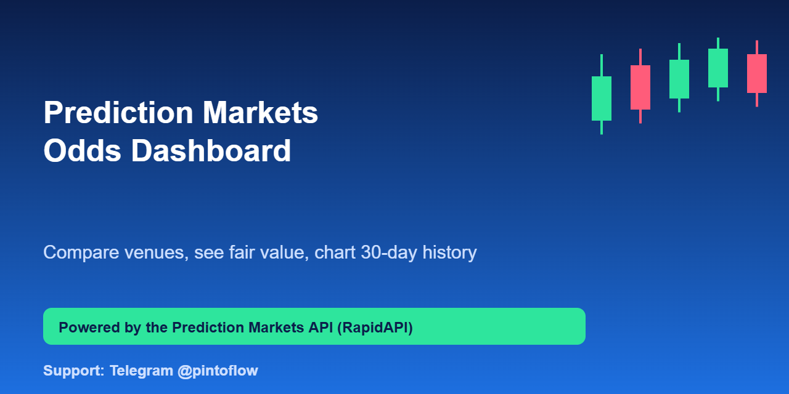
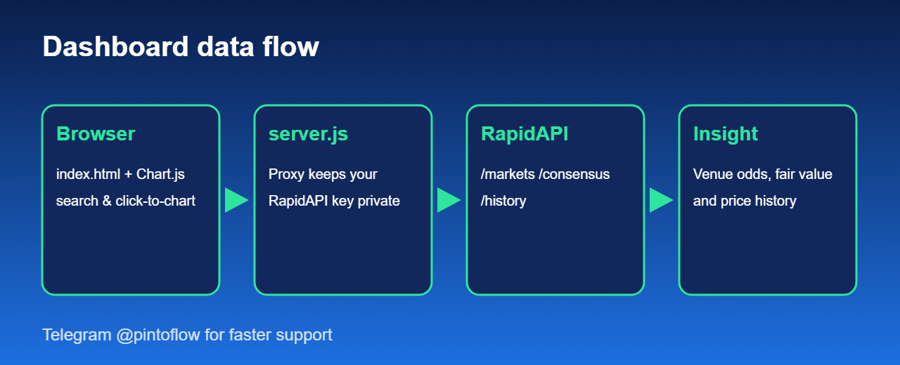

<p align="center"></p>

# Prediction Markets Odds Dashboard

A single-page dashboard that answers "what does the market think?" Search any topic and see **Polymarket, Kalshi and Manifold** odds side by side, a **consensus fair-value** probability, and a **30-day price chart** for any market. Built on the [Prediction Markets API](https://rapidapi.com/belchiorarkad-FqvHs2EDOtP/api/prediction-markets).

> ⚡ Need help or a custom version? Telegram **[@pintoflow](https://t.me/pintoflow)**



## Run it

```bash
git clone https://github.com/BelNaruto/prediction-markets-odds-dashboard
cd prediction-markets-odds-dashboard
export RAPIDAPI_KEY=your-key RAPIDAPI_HOST=host-from-the-endpoints-tab
node server.js          # open http://localhost:3000
```

Get a key (free plan available): https://rapidapi.com/belchiorarkad-FqvHs2EDOtP/api/prediction-markets

## Why a tiny proxy?

Browsers should never hold your RapidAPI key. `server.js` serves `index.html` and forwards `/api/*` to RapidAPI with your headers added server-side, so the key never reaches the page. It also avoids CORS issues.

## What it shows

- **Consensus gauge:** `/api/consensus` volume-weighted probability and venue spread
- **Market table:** `/api/markets?q=` normalized Yes probability and volume per venue
- **History chart:** `/api/history/{venue}/{id}?interval=1d&lookback=30d` via Chart.js

## Use cases

- Election and macro nights: put it on a second screen
- Embed the consensus number in a newsletter or blog post
- Starting point for a trading journal or a media widget

## Ideas to extend

- Add a "biggest venue disagreement" panel using `/api/arbitrage`
- Auto-refresh every 30 seconds with caching
- Save watchlists in localStorage

## Disclaimer

Informational only, not financial advice. Not affiliated with Polymarket, Kalshi or Manifold.

---
⚡ **Need help fast? Telegram [@pintoflow](https://t.me/pintoflow)** · API: [https://rapidapi.com/belchiorarkad-FqvHs2EDOtP/api/prediction-markets](https://rapidapi.com/belchiorarkad-FqvHs2EDOtP/api/prediction-markets) · MIT license
